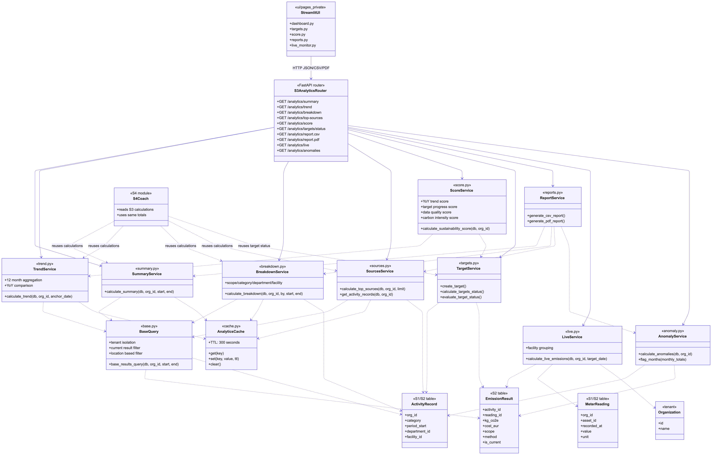
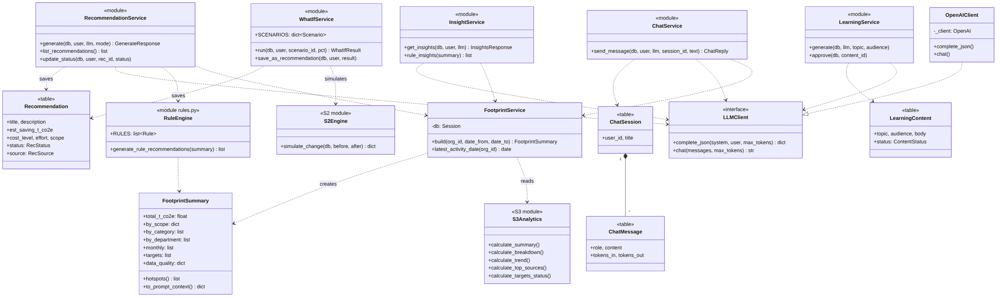

# CarbonLens
CarbonLens — Enterprise Carbon Footprint Tracker & AI Assistant (FH Dortmund Capstone)

## 📖 Project Description
CarbonLens is a full-stack Python web platform that helps companies track their greenhouse gas emissions. Companies can record their operational activity (like electricity usage, flights, or vehicle fuel), and the system automatically converts this data into exact CO2e emissions using international standards (the GHG Protocol). It then visualizes the data on a dashboard and uses an AI Coach to suggest tailored ways to reduce their carbon footprint.

**Technology Stack:** FastAPI (Backend) · Streamlit (Frontend) · PostgreSQL 16 (Database) · Docker (Deployment) · OpenAI API (AI Coach).

## 👥 Team Overview & Roles
Each team member owns one subsystem end-to-end, including the database models, API routes, UI pages, and unit tests for their respective sections.

| Member | Name | Role | Subsystem | Key Responsibilities |
| :--- | :--- | :--- | :--- | :--- |
| **Member 1** | **Saba Brahmani** | Data & Database Engineer | **S1: Data & Identity** | Database schema, Alembic migrations, Authentication (JWT), Activity records, CSV imports, Tenant isolation, Assets & Meter Readings. |
| **Member 2** | **Tuba Jabeen** | Carbon Engine & DevOps | **S2: Emission Engine** | Emission factor database, unit conversions, Scope 1/2/3 classification, calculation core, what-if simulations, and Docker setup. |
| **Member 3** | **Sameer Ghaffar** | Analytics & Frontend Lead | **S3: Analytics & Reporting** | Streamlit website shell, main dashboard, sustainability score, tracking reduction targets, live monitoring, and PDF/CSV reports. |
| **Member 4** | **Mustafa Mulla Khil** | AI Engineer & Integration | **S4: AI Coach** | OpenAI integration, grounded chat (using company data), personalized recommendations, intelligent free-text identification, and the learning hub. |

## 🏗️ System Architecture
The project runs in three Docker containers (Database, API, UI).
Data flows from **S1 (Data Entry)** ➔ **S2 (Calculation)** ➔ **S3 (Dashboard/Reports)** ➔ **S4 (AI Advice)**.

## 🚀 How to Run
Requirements: Docker Desktop (running) and Git.

```bash
git clone https://github.com/sababaloch1/carbonlens.git
cd carbonlens
cp .env.example .env        # Windows PowerShell: Copy-Item .env.example .env
# open .env and set JWT_SECRET to any long random string
docker compose up --build
```

- App (Streamlit): http://localhost:8501
- API docs (Swagger): http://localhost:8000/docs
- The API container runs the migrations and loads the demo data (factors, tariffs, about 240 activities) by itself.
- Fresh start (deletes all data): `docker compose down -v`
- Tests: `pytest` (Python 3.12; set `JWT_SECRET` in the environment)

## 🔑 Demo Login
| Email | Password |
|---|---|
| `user2acc@carbonlens.local` | `user2account` |

## 🎥 Screencast (7 minutes)
Link: (https://drive.google.com/drive/folders/1A5gfNWLwUABo833Vm0TaAc_2JiNzuiTt?dmr=1&ec=wgc-drive-hero-goto)

---
## Documentation
- [S1 Data & Identity (how it works, API, how to run)](docs/S1_Data_and_Identity.md)
- [S2 Emission Engine (how it works, API, requirements, how to run)](docs/S2_Emission_Engine.md)
- [S3 Analytics & Reporting (how it works, API, tests, UML)](docs/S3_Analytics_Reporting.md)
- [S4 AI Sustainability Coach (how it works, API, requirements, how to run)](docs/S4_AI_Coach.md)

## System Design (UML Diagrams)

### S1 – Data & Identity (Saba)


### S2 – Emission Engine (Tuba Jabeen)


### S3 – Analytics & Reporting (Sameer Ghaffar)



### S4 – AI Sustainability Coach (Mustafa Mulla Khil)

